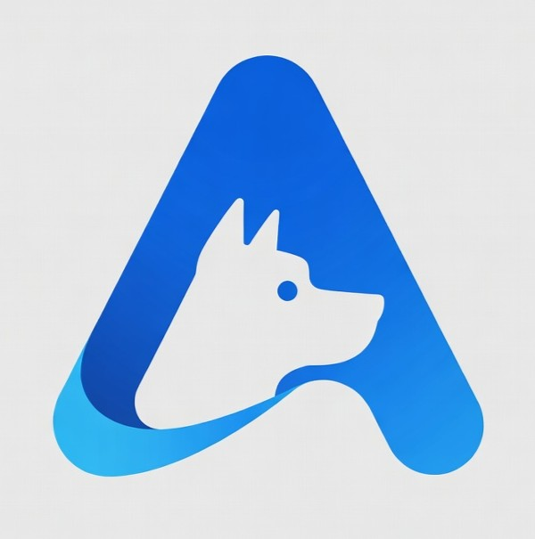

# az9s



**A fast, keyboard-first terminal UI for operating Azure, built for platform engineers.**

Browse every subscription, resource group and resource from the terminal, filter
instantly, and (soon) act on resources and check Azure Policy compliance, the way k9s
works for Kubernetes.

> ⚠️ **Status: early development.** The app browses resources across
> all your subscriptions with Azure Resource Graph and never freezes while loading.
> It is read-only for now. See the [Roadmap](ROADMAP.md).

## Features

| Today | Planned |
|---|---|
| Management group tree → subscriptions → resource groups → resources → detail (Overview, Tags, Policy, JSON) | Command palette, config file, `:ctx` (M2) |
| Resource groups across a whole management group, or all subscriptions (`:rg all`, `:res all`) via Azure Resource Graph | Azure Policy at management-group scope: assignments, compliance, exemptions (M3) |
| Instant views from a local cache, refreshed in the background, with data age in the status bar | Safe actions: VM start/stop, restarts, tags, delete, policy scans (M4) |
| Policy assignments per scope with inheritance and compliance (`:policy`); compliance summary per scope; drill down to non-compliant resources, and each resource's policy states | Compliance roll-up, exemptions (M3) |
| Filters (`type=`, `loc=`, `tag=`), a resource-type summary (`:type`), `/` text filter, `y` copy ID, `o` open in Portal, vim keys | AKS, Key Vault, logs, themes (M5) |

## Requirements

- [Rust](https://rustup.rs) 1.88 or newer and a C compiler (`build-essential` on
  Debian/Ubuntu/WSL; Xcode command line tools on macOS). OpenSSL and `pkg-config`
  are **not** needed: TLS uses rustls.
- [Azure CLI](https://learn.microsoft.com/cli/azure/install-azure-cli), logged in with
  `az login`
- A terminal with colour support. On a light background use `theme = "light"`;
  `theme = "mono"` (or `NO_COLOR=1`) uses no colours at all.

## Install

Download a prebuilt binary for Linux, macOS or Windows from
[Releases](https://github.com/mrWiecek/az9s/releases), or build from source:

```bash
cargo install --git https://github.com/mrWiecek/az9s --locked az9s              # latest
cargo install --git https://github.com/mrWiecek/az9s --tag v0.3.0 --locked az9s # a specific version
```

`az9s --version` shows the installed version and commit. Versions follow
SemVer; see [CHANGELOG.md](CHANGELOG.md) for what changed and
[RELEASING.md](RELEASING.md) for how to roll back.

## Quick start

```bash
az login                                   # authenticate once (az9s uses your Azure CLI login)
az9s                                       # launch
az9s --timings                             # launch, print a timing summary on exit
```

## Keys

| Key | Action |
|---|---|
| `j` / `k`, `↑` / `↓` | Move down / up |
| `g` / `G` | First / last item |
| `Ctrl+D` / `Ctrl+U` | Page down / up |
| `Enter` | Open (in the tree: resource groups of the group or subscription) |
| `Space`, `l`/`→`, `h`/`←` | Tree: open/close a group (`h` on a closed row goes to the parent) |
| `Esc` / `Backspace` | Back, clear filter, or dismiss error |
| `/` | Filter the list; in the detail view, search like Vim (`n`/`N` next/previous) |
| `:` | Command mode; suggestions as you type, `Tab` completes |
| `Ctrl+P` | Go to anything: fuzzy search over commands, subscriptions, management groups and the loaded resource groups and resources |
| `r` | Refresh |
| `y` | Copy the selected item's Azure ID (works over SSH; in tmux enable `set-clipboard`) |
| `c` | Copy the current view: all filtered rows of a list (tab-separated, pastes into a spreadsheet), or the detail view's tab (Overview, Tags, Policy, JSON) |
| `o` | Open the selected item in the Azure Portal |
| `Tab`, `1`-`4` | Detail view: Overview / Tags / Policy / JSON |
| `Enter` (Tags tab) | Every resource in the tenant with the selected tag |
| `Enter` (Policy tab) | The selected policy's definition (initiative or direct, and where it is assigned, show in the tab) |
| `?` | Help |
| `q` / `Ctrl+C` | Quit |

## Commands

| Command | Shows |
|---|---|
| `:ra [all\|<mg>\|<sub>]` | Role assignments that matter there: inherited from management groups above, at the scope, and below it (resource groups, resources). Principal names come from Microsoft Graph; `C`/`B` mark custom and built-in roles. `Enter` opens the role's permissions; `d` the assignment |
| `p` (in `:ra`), `:access <principal>` | Everything one user, group or app can do across the tenant: its own role assignments and those of its groups (nested too), each marked "direct" or "via *group*". `:access` takes a name, sign-in name, app ID or object ID |
| `:group [name]` | Directory groups: kind (security, Microsoft 365, distribution), dynamic or assigned, `R` role-assignable. `Enter` lists the members (`t` direct / nested); `Enter` on a member opens a group's members or a user's or app's groups. `p` shows Azure access, `o` the Entra page |
| `:role` | Role definitions, custom first, with how many assignments each has; `Enter` lists who has the role, `d` its permissions (actions, data actions, assignable scopes) |
| `:exemption [all\|<mg>\|<sub>]` | Policy exemptions at or below the scope: category, expiry (red when expired, yellow within 30 days), assignment, scope and reason, soonest to expire first; `Enter` opens one |
| `:compliance [all\|<mg>]` | Subscriptions ranked by non-compliant resources (with % compliant and their management group), worst first; `Enter` opens `:policy` for one. The management group tree shows the same compliance on every group and subscription |
| `:policy [all\|<sub>]` | Policy assignments that apply there (assigned or inherited from management groups), with non-compliant resource counts, worst first, under a compliance summary for the scope (% compliant, non-compliant resources, subscriptions and assignments affected). `Enter`: the assignment's non-compliant resources; `d`: the assignment itself |
| `:ctx [all\|<tenant>]` | Tenants you can use (`Enter` switches), or switch by name, domain or ID; `all` returns to the default login |
| `:mg` | Management group tree (the start view) |
| `:sub` | Subscriptions |
| `:rg [all\|<sub>] [loc=… tag=…]` | Resource groups. Without a scope: where you are (the highlighted or current subscription or management group; all subscriptions if none) |
| `:res [all\|<sub>] [filters]` | Resources, scoped like `:rg`, e.g. `:res all type=vm loc=westeurope tag=env=prod` (`type=` takes aliases like `vm`, `vnet`, `keyvault`, the type's last part, the full type, or a provider). `?` in the app has more examples |
| `:type [all\|<sub>] [filters]` | Resource counts per type; `Enter` lists that type |
| `:tag [all\|<sub>] [filters]` | Tags (key, value, how many resources); `Enter` lists the resources with that tag |

## Development

Requires [just](https://github.com/casey/just).

```bash
just run         # run (release mode, logs off)
just run-debug   # run with debug logs written to az9s.log
just run-timings # run, then print Azure/cache/frame timings on exit
just perf        # rendering benchmark with 100k rows
just ci          # everything CI runs: fmt check, clippy, tests
just --list      # all recipes
```

```
crates/
├── az9s         # binary entry point
├── az9s-core    # state, navigation, SQLite cache
├── az9s-azure   # Azure auth + API client
└── az9s-tui     # ratatui UI
```

How it fits together: [docs/ARCHITECTURE.md](docs/ARCHITECTURE.md).

## Configuration

Optional. `az9s --init-config` writes a commented file with the defaults;
`az9s --help` shows where it lives (Linux/WSL: `~/.config/az9s/config.toml`;
macOS: `~/Library/Application Support/az9s/config.toml`; Windows:
`%APPDATA%\az9s\config\config.toml`). `--config <path>` or `AZ9S_CONFIG`
use another file.

```toml
start = "mg"                               # first view: "mg" (tree) or "sub"
default_subscription = "prod-connectivity" # for :rg/:res/:type/:tag without context
tenant = "<tenant-id>"                     # start in this tenant (like :ctx)
theme = "default"                          # "default" (dark), "light" or "mono"; NO_COLOR forces mono
refresh_interval = 120                     # auto-refresh every N s (min 30); 0 = off
read_only = true                           # status bar shows RO; actions (M4) disabled
```

A mistake in the file (unknown key, wrong type) doesn't stop az9s: it starts
with the defaults and the status bar names the line and the problem.

## Troubleshooting

| Symptom | Try |
|---|---|
| "Not connected to Azure" | Run `az login`, then press `r` |
| "the Azure CLI (az) was not found" | Install the Azure CLI and check `az --version` runs in the same terminal. On Windows, update to az9s 0.12.1 or later (earlier versions couldn't start `az.cmd`) |
| "No read access to management groups" | Expected without Reader on management groups: az9s starts on the subscription list, and `:sub`, `:rg`, `:res` work. Set `start = "sub"` in the config to skip the tree |
| "Management group tree unavailable" | You need read access on the tenant root management group; `:sub` and `:rg all` still work |
| Status bar says "Resource Graph unavailable … used ARM" | Lists still load, but more slowly; check `just run-debug` logs |
| A resource you just changed looks stale | Resource Graph can lag ARM briefly; press `r`, or run with `AZ9S_BACKEND=arm` |
| `o` says "No browser could be started" (e.g. WSL) | The Portal link is copied instead; paste it into a browser. On WSL, installing `wslu` (`wslview`) helps, though az9s also tries `cmd.exe` |
| `:ctx` switch fails with "no token for tenant" | Run `az login --tenant <id>` once for that tenant, then switch again |
| Something feels slow | Run `az9s --timings` and include the table in an issue |

## Contributing

Issues and PRs are welcome. Start with [ROADMAP.md](ROADMAP.md) and
[CONTRIBUTING.md](CONTRIBUTING.md). Record user-visible changes under
`[Unreleased]` in [CHANGELOG.md](CHANGELOG.md), and bump the version for code
changes (`just bump patch|minor|major`; see [RELEASING.md](RELEASING.md)).

## License

[Apache License 2.0](LICENSE).
